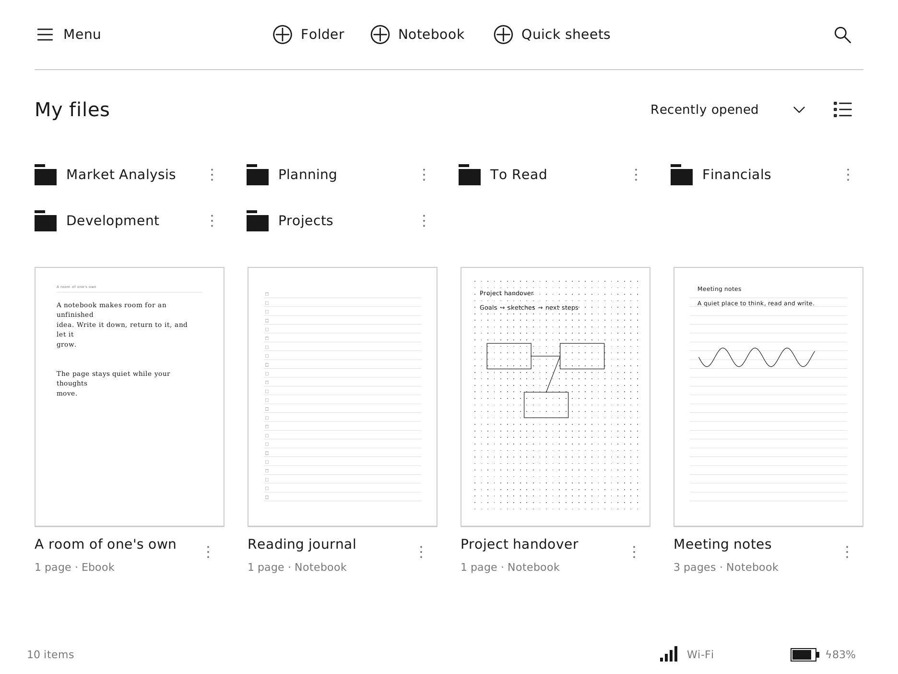
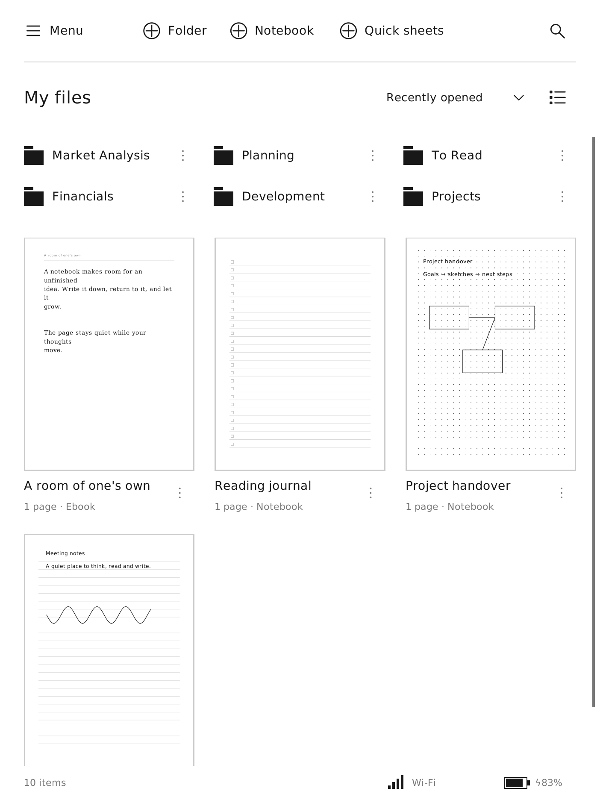
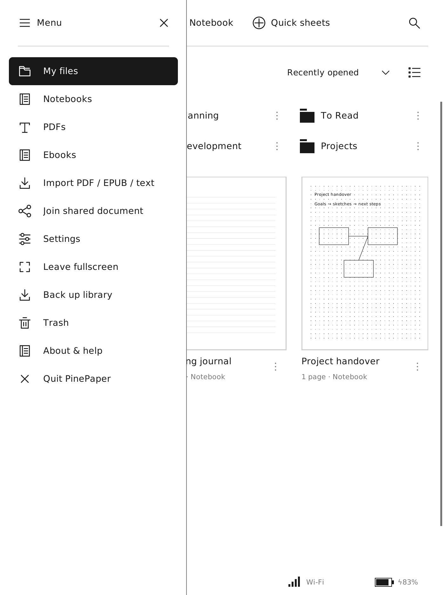

# Feature and interface inventory

Reviewed **20 October 2026**. This is the implementation checklist for PinePaper,
based on the user's library photograph and reMarkable's public support guides.
It is not a claim of compatibility with reMarkable files, hardware or cloud services.

The supplied [Features and functionality index][index] returned a Salesforce
loading/error shell. The public printable articles linked below were readable;
their embedded UI illustrations were inspected too. This review covers the core
library, writing, reading, organization, sharing and settings workflows. It is
not an exhaustive crawl of every help-center article.

Documentation spans different devices and software versions. In particular,
[release 3.12][312] changed My files. We deliberately use the user's photograph
as the library's visual baseline: separate Folder, Notebook and Quick sheets
actions, with folders above page previews. The guides supply interaction ideas;
their newer layouts do not override that choice. PinePaper uses its own vector
icons and renderer; no reMarkable raster artwork is bundled.

## Interface references

| Surface | Appearance and interaction to carry into PinePaper | Visual reference |
| --- | --- | --- |
| Library | Thin header rule, plain icon/text creation actions, left-aligned heading, sort at right, compact folder rows, portrait previews with captions underneath. Keep system status quiet but visible. | User-supplied photograph; [My files evolution][312] |
| Navigation | A left sidebar groups destinations. The recent/favorite drawer floats above the open document. | [Navigation guide][navigation], [drawer illustration](https://support.remarkable.com/servlet/rtaImage?eid=ka0QD000000OraD&feoid=00N7Q00000CxZiV&refid=0EM7Q000000hQI5) |
| Writing toolbar | Narrow vertical tool strip. Selection uses a black tile with a white icon. Tool options stay in a bounded panel beside the toolbar; the page remains visible. | [Toolbar][toolbar], [panel illustration](https://support.remarkable.com/servlet/rtaImage?eid=ka0QD000000VCBN&feoid=00N7Q00000CxZiV&refid=0EMQD00000I1IgU) |
| Pen settings | Illustrated nib choices, stroke samples for thickness, circular color choices and thin section dividers. | [Writing tools][writing], [palette illustration](https://support.remarkable.com/servlet/rtaImage?eid=ka0QD000000VC6X&feoid=00N7Q00000CxZiV&refid=0EMQD000007gIED) |
| Reading | Page dominates the screen. Navigation and layout controls appear on demand. PinePaper should retain a small toolbar handle and quiet progress information. | [Ebooks][ebooks], [Import and continue][import] |
| Templates | Show miniature paper previews, not just template names. Cornell paper has a heading area, cue column and larger lined notes column. | [Templates][templates], [Cornell illustration](https://support.remarkable.com/servlet/rtaImage?eid=ka0QD000000VCCz&feoid=00N7Q00000CxZiV&refid=0EM7Q000000hSUn) |
| Layers | A compact ordered stack with an unmistakable active row; template/background stays separate. | [Layers][layers] |
| Search | Result snippets and marked matches connect search results to locations inside documents. | [Handwriting search][handsearch], [results illustration](https://support.remarkable.com/servlet/rtaImage?eid=ka0QD000000OOcH&feoid=00N7Q00000CxZiV&refid=0EMQD00000HdQFO) |

Official image links may change as the support center revises articles. They are
references, not runtime dependencies. These are **PinePaper's own rendered UI**:

| Portrait library | Navigation sidebar |
| --- | --- |
|  |  |

## Functionality and current implementation

**Implemented now** means included in this change. **Existing** means available
before this change. **Partial** identifies a working subset with concrete gaps.
**Planned** means there is no corresponding completed feature. These labels
refer to the source tree, not whether a tablet has received the new binary.

| Area | Documented behavior / UI pattern | PinePaper status and remaining work |
| --- | --- | --- |
| Home and folders | Sidebar, file-type destinations, folder browsing. [Guide][navigation] | **Implemented now:** Menu sidebar, compact folder rows, back navigation, separate document previews. |
| Grid / list | Alternate file presentations. [Guide][navigation] | **Implemented now:** grid/list toggle beside sorting; choice persists across restarts. |
| Sorting | Multiple sort fields and directions. [Guide][navigation] | **Partial:** recent, name, created, modified and type sorts; persisted. File size and reverse direction remain. |
| Creation | Notebook creation and scratch-paper access. [My files][312] | **Implemented now:** direct Notebook and Folder buttons; Quick sheets appends a fresh page to a persistent scratch notebook. Renaming/moving it retains its identity; trashing it creates a new one next time. |
| File search | Names and document contents. [Guide][navigation] | **Partial:** case-insensitive filename search now reaches nested folders; clear-search control. Content index and match navigation remain. |
| Type filters | Ebooks remain discoverable across folders. [Guide][ebooks] | **Implemented now:** Notebooks / PDFs / Ebooks search the whole active library; My files returns to the root. |
| Favorites / recents | Starred files and a recent-file drawer. [Guide][navigation] | **Partial:** recent sorting exists. Favorites metadata, starred controls and drawer remain. |
| File actions | Selection and contextual operations. [Guide][navigation] | **Partial:** per-item menu for rename, move and trash; restore available in trash. Batch selection, duplicate, permanent purge and long-press action bar remain. |
| Writing tools | Pressure-sensitive nib families and configurable ink. [Guide][writing] | **Partial:** six nibs, three widths, grayscale ink and highlighter. Paintbrush/shader, tilt behavior and per-document tool memory remain. |
| Tool palette | Compact options and two quick tool slots. [Guide][toolbar] | **Partial:** anchored pen panel, selection highlighting and outside-tap dismissal exist. Dedicated nib pictograms, second quick slot and movable/right-handed toolbar remain. |
| Shapes | Straight strokes and shape correction after holding. [Guide][writing] | **Planned:** optional hold-to-straighten; shape recognition must preserve original stroke history and remain off the live ink path. |
| Highlighting | Freehand and text-aligned highlighting. [Guide][writing] | **Partial:** freehand gray highlight exists. PDF text geometry and snap-to-text selection remain. |
| Eraser | Erase modes and selection tools. [Guide][toolbar] | **Partial:** whole-stroke eraser and clear page exist. Segment/area erasing with reversible edits remains. |
| Selection | Move, scale, rotate and reuse content. [Guide][toolbar] | **Partial:** lasso move/delete exists. Resize/rotate, duplicate/cut/copy/paste across pages and object handles remain. |
| Undo / redo | Reversible document editing. [Guide][toolbar] | **Existing:** page drawing undo/redo. Structural operations need consistent history before expanding page and layer tools. |
| Typed text | Formatting and mixed handwriting/typing. [Guide][typing] | **Partial:** movable/editable text objects, physical keyboard and built-in fullscreen keyboard. Rich text, lists and text/ink anchoring remain. |
| Handwriting conversion | Convert a selection or document into text. [Guide][conversion] | **Planned:** evaluate an offline engine or explicitly configured provider. reMarkable's account-backed conversion is not available to this app. Preserve ink before any conversion. |
| Handwriting search | Indexed handwriting, snippets and highlighted matches. [Guide][handsearch] | **Planned:** local indexing and ink-to-text recognition. Keep filename search fast without waiting for OCR. |
| Page overview | Thumbnails and page organization. [Guide][navigation] | **Partial:** page thumbnails, outlined current page, page creation/deletion, bookmarks and page-tag filtering. Multi-select, duplicate/reorder and moving pages between notebooks remain. |
| Templates | Paper families, recents and a visual picker. [Guide][templates] | **Partial:** Lined, Blank, Dots, Grid, Checklist and Music exist. Preview tiles, Cornell/planner papers, orientation-aware patterns and recent templates remain. |
| Layers | Visible/hidden layers, order, merge and background. [Guide][layers] | **Planned:** no layer stack currently. Requires a backward-compatible payload extension, export rules and collaboration operations. |
| Tags | File/folder/page tags and global management. [Guide][tags] | **Partial:** page tags and overview filtering exist. Global tag browser, file/folder tags, rename and delete remain. |
| Reader navigation | Swipes, overview, jump-to-page and quick browse. [Guide][ebooks] | **Partial:** swipes, edge taps, previous/next, overview and saved position exist. Go-to-page input and preview scrubber remain. |
| PDF view | Fit and custom crop/pan. [Guide][navigation] | **Partial:** fit-page/width and scrolling exist. Pinch zoom, two-finger pan and persistent crop remain. |
| EPUB layout | Font, spacing, alignment and margins. [Guide][ebooks] | **Partial:** text EPUB import and fixed pagination exist; images/CSS and adjustable reflow remain. Pagination changes need stable annotation anchors. |
| Reading note pages | Insert notes while protecting original pages. [Guide][ebooks] | **Partial:** notebook page insertion exists. Source-page identity must be separated from notebook position before supporting inserted PDF/EPUB note pages safely. |
| Import | Documents and image-based pages. [Guide][webapp] | **Partial:** local PDF, text EPUB and UTF-8 text import exist. Image pages and DOCX conversion remain. No cloud import is implied. |
| Export | Selected pages, PDF, images and vector output. [Guide][email] | **Partial:** full annotated PDF export exists and is rasterized. Page selection, PNG/SVG and vector-preserving PDF remain. |
| Screen sharing | Document-only live presentation. [Guide][screenshare] | **Planned:** presentation-only viewer. Existing editable sharing is a different workflow. |
| Editable collaboration | PinePaper-specific multi-person document editing. | **Existing:** five-character rooms over WebSocket through a user-configured stateless relay. Preserve this feature; do not turn the relay into cloud storage. |
| Cloud integrations | Import/export with external storage providers. [Guide][integrations] | **Planned / optional:** provider adapters and explicit sign-in if requested. No reMarkable account/Connect compatibility. Local files and backups remain independent. |
| Email / public links | Cloud-mediated delivery and document links. [Guides][email], [web app][webapp] | **Planned / optional:** use exported files first. Any hosted delivery needs separate user-approved service configuration. |
| Device settings | Network, battery, storage, security, accessibility. [Guide][navigation] | **Partial:** live battery/Wi-Fi status and UI sizing exist. Wi-Fi connection manager, storage screen, handedness and application language remain. Device locking/suspend belongs to OS integration. |
| PineNote display | PinePaper-specific e-ink and front-light controls. | **Existing:** live brightness, warmth, contrast, gamma, refresh profiles and manual refresh, switches/sliders, periodic cleanup. Keep these controls and status indicators in fullscreen. |
| Desktop / mobile | Companion access and cross-device workflows. [Web app][webapp] | **Partial:** the same native app runs on Linux Wayland desktops; there is no browser/mobile companion. |

The [release overview][releases] also covers newer additions such as capture,
links and service integrations. They are outside the first implementation slice;
they need a separate interaction and data-model design before becoming UI controls.

## Implementation sequence

### 1. Library foundation — completed in this change

- Match the supplied composition in portrait and landscape, with native monochrome icons.
- Separate folder rows from full-page document thumbnails; add continuously scrolling grid/list views.
- Provide direct creation, persistent Quick sheets, sort choices, global type/name search and sidebar navigation.
- Keep Wi-Fi/battery visible and prevent periodic status updates from repainting the header.
- Clip both drawing and input regions, so partially visible items cannot intercept fixed controls.
- Preserve existing libraries and the low-latency drawing path; no schema migration is required.

Acceptance checks: new regression coverage verifies scratch-notebook identity,
ink preservation, trash behavior, nested search, saved view/sort preferences,
all-items reachability and header preservation at both PineNote orientations.
The native Wayland smoke test verifies direct notebook creation and retained pen,
popover, rotation, keyboard and fullscreen behavior. `--smoke` generates the UI
previews above from disposable sample data.

### 2. Organization and contextual controls — next

Add favorites and a recent/favorite drawer; file multiselect and duplicate; a
visual template picker; page duplicate/reorder and a direct page-number input.
Replace generic nib samples with recognizable native nib icons, introduce a
second saved tool slot, and support right-handed toolbar placement. Keep menus
anchored, dismissible and usable in portrait. Add global tags after defining
how file and page tags coexist.

Acceptance: every file action has a real implementation, all destructive actions
are undoable or explicitly confirmed, and keyboard/pen/touch reach the same actions.

### 3. Editing and reader foundations

Implement selection transforms and clipboard operations, layers, optional line
correction, rich text, then PDF/EPUB source-page identities, note-page insertion,
reflow controls and scrub navigation. Introduce versioned payload extensions
before layers; preserve unknown fields when loading older/newer documents.
Extend export, backups and collaboration together with each new edit operation.

Acceptance: round-trip an old library, reopen exports, restore a backup and merge
concurrent edits without dropping content. Measure pen latency on the tablet;
recognition, thumbnails and indexing must not run synchronously during strokes.

### 4. Optional services and recognition

Evaluate local handwriting recognition/indexing separately, with downloadable
language models if needed. Add document-only presentation and provider adapters
only with defined authentication, retention and offline behavior. Build these
outside the ink renderer. The exchange relay remains transient and stateless.

## Source list

All links below are official reMarkable sources. Their behavior is reference
material; the implementation choices and staged work above are PinePaper's.

[index]: https://support.remarkable.com/s/topic/0TOQD0000002LDF4A2/features-and-functionality
[navigation]: https://support.remarkable.com/articles/Knowledge/Navigating-on-your-reMarkable
[toolbar]: https://support.remarkable.com/articles/Knowledge/Toolbar
[writing]: https://support.remarkable.com/articles/Knowledge/Writing-tools
[layers]: https://support.remarkable.com/articles/Knowledge/Layers
[templates]: https://support.remarkable.com/articles/Knowledge/Templates
[tags]: https://support.remarkable.com/articles/Knowledge/Tags
[ebooks]: https://support.remarkable.com/articles/Knowledge/Ebooks
[typing]: https://support.remarkable.com/articles/Knowledge/Combining-handwriting-and-typing-on-reMarkable
[conversion]: https://support.remarkable.com/articles/Knowledge/Convert-handwritten-notes-into-text
[handsearch]: https://support.remarkable.com/articles/Knowledge/Handwriting-search
[integrations]: https://support.remarkable.com/articles/Knowledge/Integrations
[screenshare]: https://support.remarkable.com/articles/Knowledge/Screen-Share
[email]: https://support.remarkable.com/articles/Knowledge/Send-by-email
[webapp]: https://support.remarkable.com/articles/Knowledge/Web-app
[releases]: https://support.remarkable.com/articles/Knowledge/Release-notes-overview
[312]: https://remarkable.com/blog/release-3-12-a-more-organized-my-files
[import]: https://support.remarkable.com/s/getting-started/step-5
